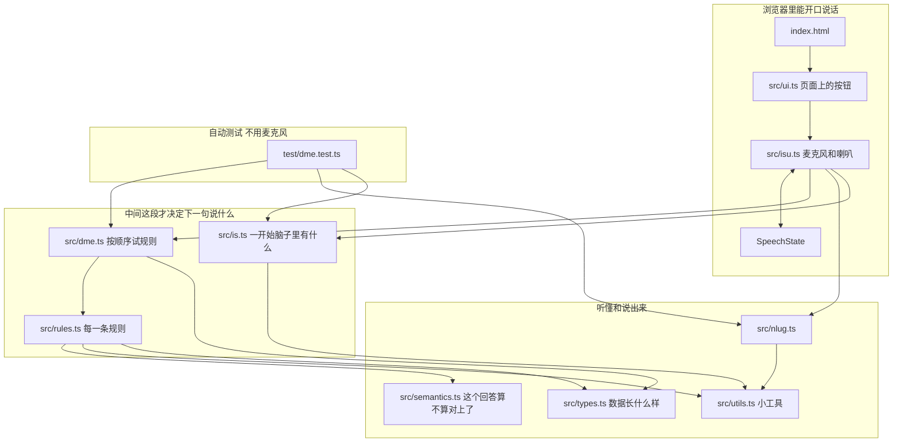
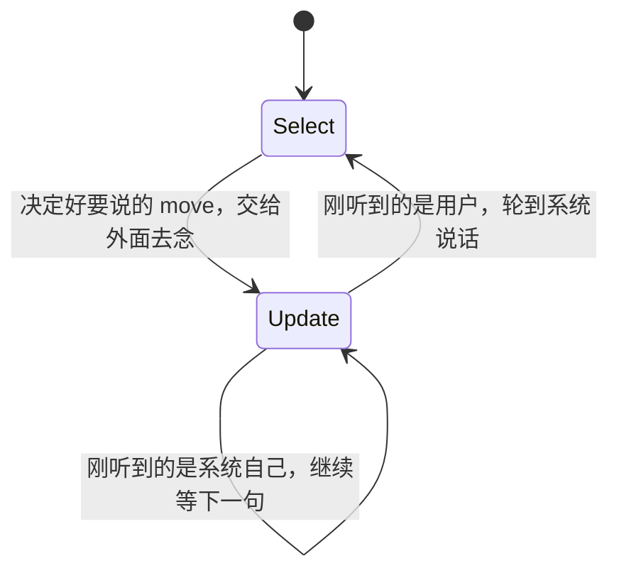
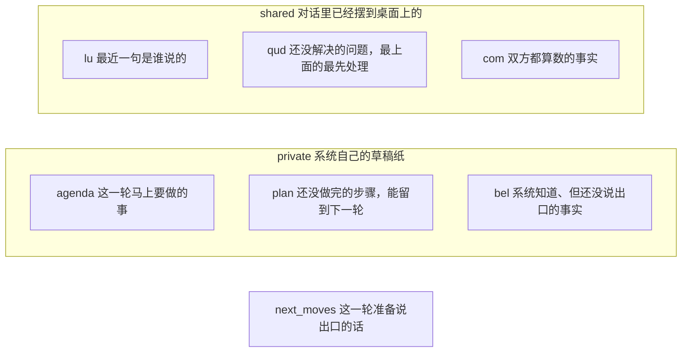
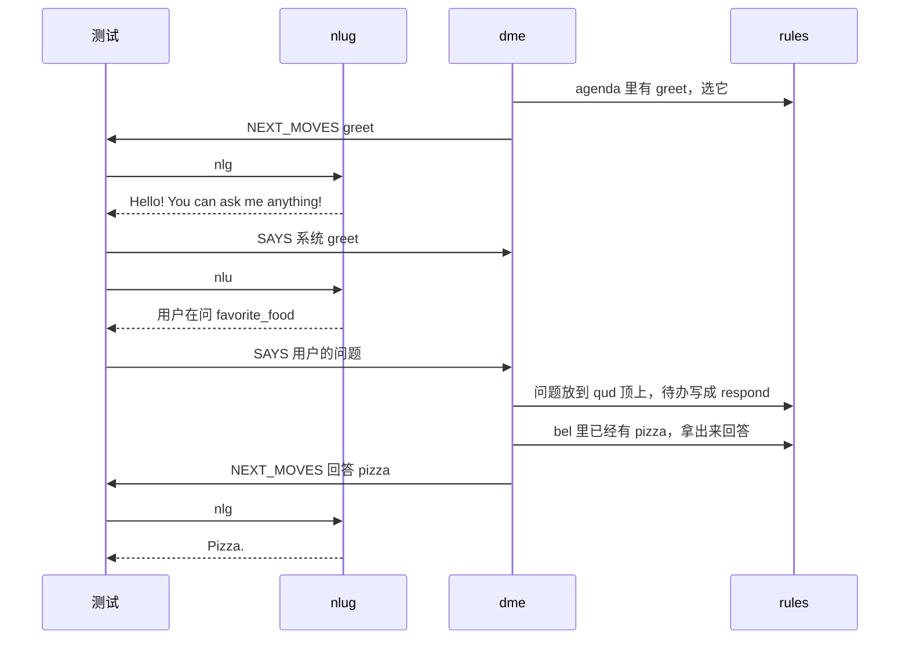
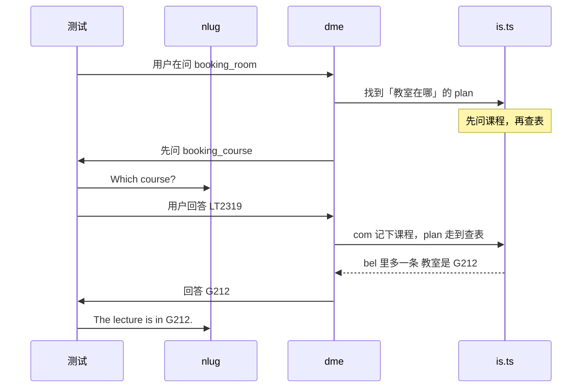

# Lab 2 代码怎么读

这份笔记讲的是 **Lab 2 还没改之前** 的 `sisu/`。目标是：随便拿现有对话里的一句话，你能指出它经过了哪个文件、改了哪一份记录。

代码里的专有名词保持英文，例如 `move`、`domain`、`qud`。旁边用大白话说它是干什么的。

## 两套入口，中间是同一套脑子

浏览器里能说话的页面，和 `npm test` 里的自动测试，中间用的是同一段程序 `dme`。差别只在两头：谁把人话变成程序能看的结构，谁把程序的决定念成句子。



`src/dipper/main.ts` 不在这张图里。那是一个更早的小例子：听到什么就重复什么。页面没引用它，编译也把它排除了。

## 决定下一句时，程序只做两件事

`dme` 里两个大状态轮流做。



用大白话写就是：

```text
一直循环:
  Select 选一句:
    看看手头的待办、计划、已经知道的事实
    决定这轮要说哪些 move
    把它们交给外面（测试或语音页面）

  Update 听一句:
    清掉这轮的临时待办
    等外面送进来一句 SAYS
    记下「刚才是谁、说了什么」
    该记的问题记上，该收下的回答收下
    已经答完的问题划掉，该查表的时候查表
    说话的人是用户 -> 回到 Select，系统该开口了
    说话的人是系统 -> 留在这里继续等
```

外面那层还要做两件 `dme` 不管的事：

1. 用户说的原句，先用 `nlu` 变成 `move`，再包成 `SAYS` 送进去。
2. 程序吐出 `NEXT_MOVES` 之后，用 `nlg` 变成英文句子。测试把句子写进记录；浏览器拿去朗读。另外要把系统自己刚说的 `move` 再送回 `dme`。不然它不知道「我刚刚问过这个问题」。

## 程序脑子里记着什么

规则改来改去的就是一份 `InformationState`。可以想成三叠纸条。



| 英文 | 把它想成 |
|---|---|
| `move` | 一句话的意思，已经不是原句了。问、答、打招呼，都是一种 `move` |
| `agenda` | 这一轮马上要做的一张纸条。一轮结束就被清空 |
| `plan` | 为了办成一件事排好的步骤。做完一步才撕掉一步 |
| `qud` | question under discussion。还挂着、没回答完的问题，最上面那个最急 |
| `com` | commitment。已经说定、后面可以拿来用的事实 |
| `bel` | belief。系统自己知道的事实，可能还没告诉用户 |

`agenda` 活不过一轮。每次进入 Update，`clear_agenda` 会把它清空。要记住「下一轮还得再问星期几」，得写在 `plan` 里。

## 现在已经能跑通的两段对话

### 用一开始就知道的事实来答

```text
系统  Hello! You can ask me anything!
用户  What's your favorite food?
系统  Pizza.
```



这条路不查表。`is.ts` 一开头就把「最喜欢的食物是 pizza」放在 `bel` 里了。

### 先追问，再查表

```text
系统  Hello! You can ask me anything!
用户  Where is the lecture?
系统  Which course?
用户  Dialogue Systems 2
系统  The lecture is in G212.
```



课表在 `src/is.ts`。哪句英文对应哪个意思，在 `src/nlug.ts`。什么时候问、什么时候查表，在 `src/rules.ts`。`src/dme.ts` 只负责按写死的顺序去试这些规则。

## 建议顺着这个顺序看

1. [types.md](types.md)：每种数据是什么。
2. [is.md](is.md) 和 [nlug.md](nlug.md)：这个小系统知道什么、听得懂什么。
3. [dme.test.md](dme.test.md)：测试怎么假装一个用户。
4. [dme.md](dme.md)：试规则的顺序。
5. [rules.md](rules.md)：每一条规则到底改了哪叠纸条。
6. [semantics.md](semantics.md) 和 [utils.md](utils.md)：怎样判断「这句回答对上了这个问题」。
7. [isu.md](isu.md) 和 [ui.md](ui.md)：同一套脑子怎么接上麦克风。
8. [dipper.md](dipper.md)：为什么那个文件可以先不看。

每一篇都按编辑器把代码折起来之后的样子分块：先给行号，再说这段干什么，并用伪代码写出逻辑。

## 和 Lab 2 作业的关系

现在它只会三件事：打招呼、用 `bel` 回答最喜欢的食物、先问课程再查一间固定教室。及格作业是在这条路上加上「星期几」和「没听懂」。

| 作业 | 你会改到的文件 |
|---|---|
| 先问星期，再按星期查教室 | `test/dme.test.ts`、`src/is.ts`、`src/nlug.ts` |
| 没听懂时道歉，并把刚才的问题再说一遍 | `src/types.ts`、`src/rules.ts`、`src/dme.ts`、`src/nlug.ts`、测试 |
| 真正用麦克风说话 | `src/isu.ts`。自动测试不走这个文件 |

`src/style.css` 和 `src/vite-env.d.ts` 只管页面长什么样，对话不经过它们。
