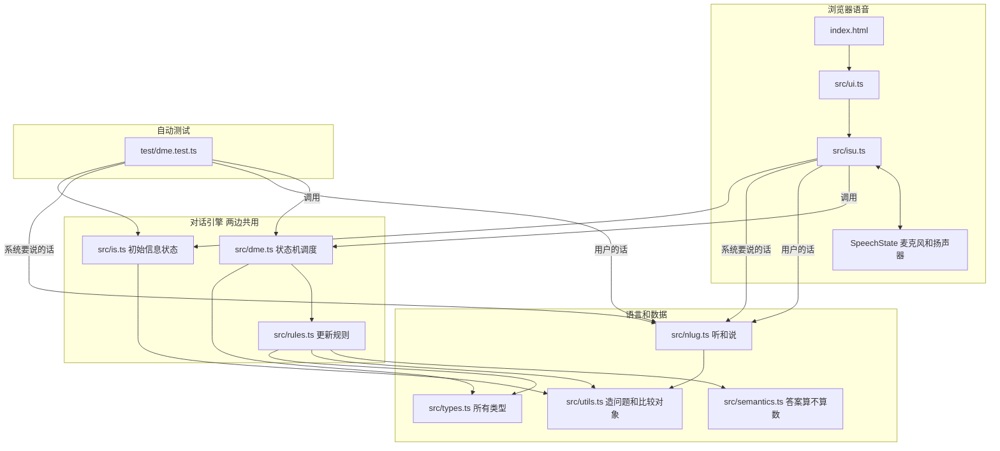
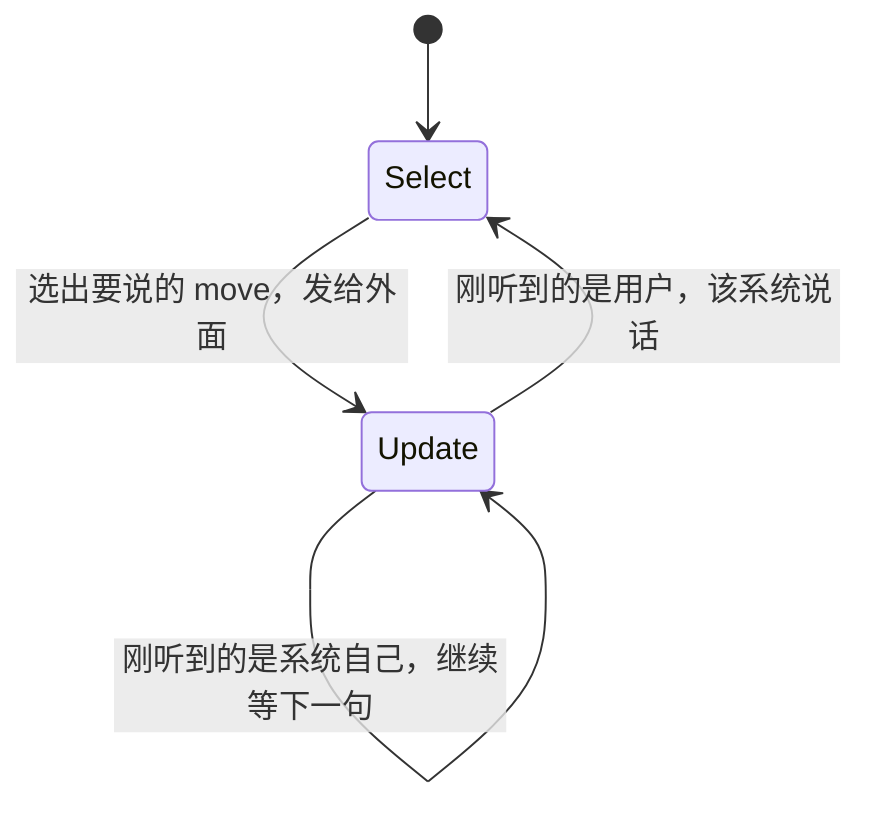
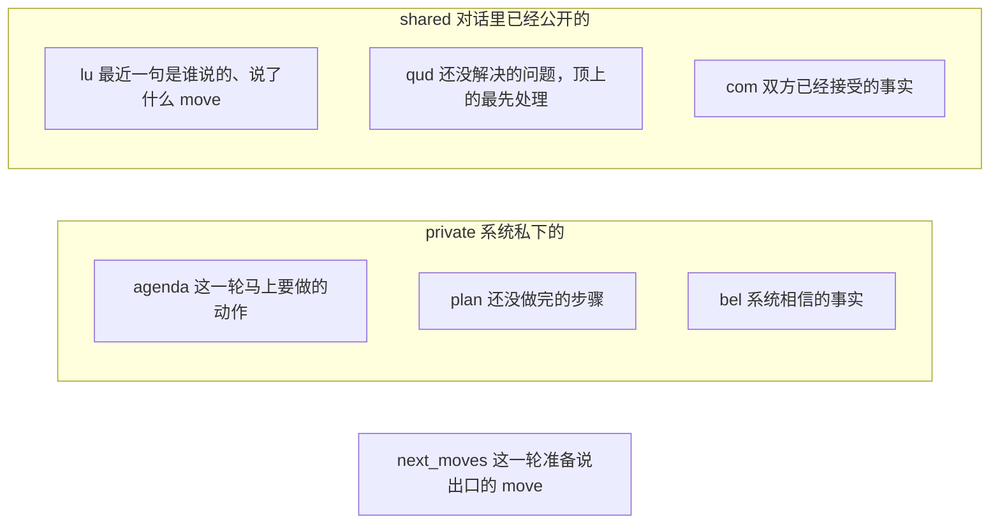
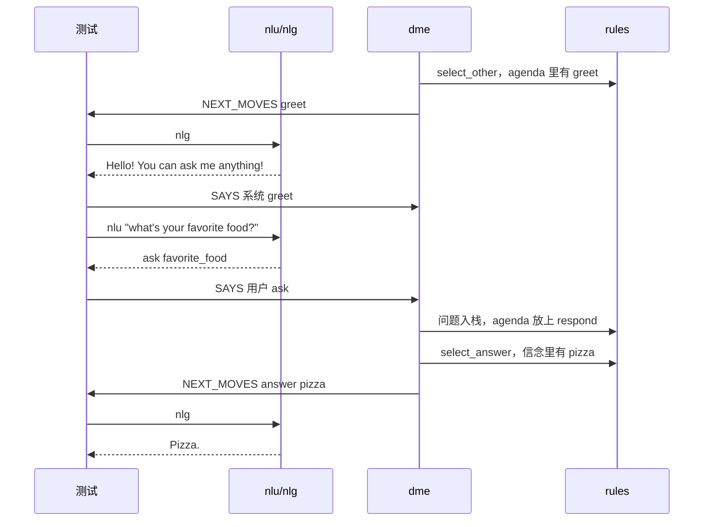
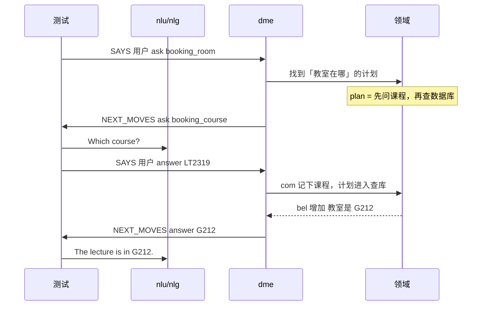

# Lab 2 代码详解：SISU 现在是怎么跑起来的

这份笔记解释的是仓库里**还没开始做 Lab 2 之前**的 `sisu/`。读完应能顺着一次对话，指出每一句话经过哪个文件、改了信息状态的哪一块。

Lab 2 要改的就是这条流水线里的领域、说法和更新规则，不是另起一个项目。

## 先看这张总图

浏览器里的语音程序，和 `npm test` 里的自动测试，用的是同一个对话引擎 `dme`。差别只在「谁把字句变成语义、谁把语义念出来」。



`src/dipper/main.ts` 不在这张图里。它是一个更早的「听到什么就重复什么」示例，`tsconfig.json` 把它排除了，页面入口也没有引用它。

## 一次对话在引擎里转一圈

`dme` 只有两个大状态，来回切换。



伪代码：

```text
loop:
  Select:
    从 agenda / plan / 信念里挑出下一步
    把它变成 next_moves
    把 next_moves 发给外层（测试或语音界面）

  Update:
    清空 agenda
    等待某一句 SAYS
    把这句记成「刚才说了什么」
    按规则并入问题栈、已确认事实、待办
    能划掉的问题划掉，该执行的计划步骤执行掉
    如果说话人是用户，回到 Select
    如果说话人是系统，留在 Update 里继续等
```

外层负责两件引擎不做的事：

1. 用户说的字符串，用 `nlu` 变成 move，再以 `SAYS` 送进引擎。
2. 引擎吐出的 `NEXT_MOVES`，用 `nlg` 变成字符串。测试把这句记进对话记录；浏览器把它交给语音合成。外层还要把系统自己的 move 再送回引擎，这样引擎才知道「我刚刚问过这个问题」。

## 信息状态里有什么

所有规则改的都是同一份 `InformationState`。可以把它看成两叠纸条加一个待说出口的列表。



记忆口诀：

| 名字 | 人话 |
|---|---|
| move | 一句话的语义。问、答、打招呼，都是 move |
| agenda | 马上要做的一张动作，做完会被清空 |
| plan | 为了回答一个大问题而排好的步骤，做完一步才删一步 |
| qud | Questions under discussion，没解决的问题栈 |
| com | commitments，已经说定、双方都算数的事实 |
| bel | beliefs，系统自己知道、但还没说出口的事实 |

`agenda` 是临时的。每进入一次 Update，`clear_agenda` 会把它清空。`plan` 才是跨轮次留下来的待办。所以「还要再问哪个问题」看 `plan`，不看 `agenda`。

## 两条已经能跑的对话

### 从信念回答

```text
系统  Hello! You can ask me anything!
用户  What's your favorite food?
系统  Pizza.
```



这条路径不查数据库。`is.ts` 里一开始就放着「最喜欢的食物是 pizza」。

### 从数据库回答

```text
系统  Hello! You can ask me anything!
用户  Where is the lecture?
系统  Which course?
用户  Dialogue Systems 2
系统  The lecture is in G212.
```



领域数据全在 `src/is.ts`。句子和语义的对照表全在 `src/nlug.ts`。什么时候问、什么时候查库，全在 `src/rules.ts`，由 `src/dme.ts` 按固定顺序尝试。

## 建议阅读顺序

1. [types.md](types.md)，先认识 move、问题和信息状态的形状。
2. [is.md](is.md) 和 [nlug.md](nlug.md)，看这个小领域会什么、听得懂什么。
3. [dme.test.md](dme.test.md)，看测试怎样假装一个用户。
4. [dme.md](dme.md)，看状态机按什么顺序点名规则。
5. [rules.md](rules.md)，逐条看规则的伪代码。
6. [semantics.md](semantics.md) 和 [utils.md](utils.md)，看「这个回答算不算对上了问题」。
7. [isu.md](isu.md) 和 [ui.md](ui.md)，看同一台引擎怎样接上麦克风。
8. [dipper.md](dipper.md)，知道那个文件为什么可以先不读。

每一篇都按编辑器折叠后的样子分块：先给行号大纲，再解释这一块做什么，并用伪代码写出逻辑。

## 和 Lab 2 的关系

现在的系统只会：打招呼、用信念回答食物、先问课程再查一间固定教室。Lab 2 及格部分是在这条流水线上加「星期」和「听不懂」。

| 任务 | 主要会碰到的文件 |
|---|---|
| 先问星期，再按星期查教室 | `test/dme.test.ts`、`src/is.ts`、`src/nlug.ts` |
| 听不懂时道歉，并重复刚才的问题 | `src/types.ts`、`src/rules.ts`、`src/dme.ts`、`src/nlug.ts`、测试 |
| 语音界面 | `src/isu.ts`。自动测试不经过它 |

`src/style.css` 和 `src/vite-env.d.ts` 只负责页面外观和 Vite 类型，对话逻辑不经过它们。
