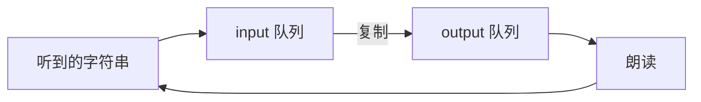

# `sisu/src/dipper/main.ts`

这是信息状态的一个更早、更小的例子：系统先说 `ping`，之后把听到的话原样说回去。它不使用 `dme`、`rules`、`nlu` 或领域数据库。

`sisu/tsconfig.json` 的 `exclude` 包含 `src/dipper`。`ui.ts` 也不引用它。读 Lab 2 的及格部分可以先跳过。放在这里是为了和真正的引擎对比：同样是「私有的输入队列和输出队列」，但没有问题栈和计划。

## 折叠大纲

```text
dipper/main.ts
├─ 6–21    检查器和语音设置
├─ 23–88   动作和守卫
├─ 89–144  状态机 Prepare / WaitToStart / Main
└─ 146–168 启动演员和按钮
```

## 6–21 行：设置

结构和 `isu.ts` 相同：北欧 Azure、英语、5 秒无输入超时。密钥那一行被注释掉了，所以这个文件即使接进页面，现在也不能完成语音准备。

## 23–88 行：队列，而不是规则表

信息状态只有两个字符串数组。

```text
is = { input: 待处理的用户话语, output: 待说的话 }

enqueue_recognition_result   把识别到的句子放进 input 前面
enqueue_input_timeout        放进字符串 "timeout"
dequeue_input                去掉 input 第一项
dequeue_output               去掉 output 第一项
enqueue_output_from_input    把 input 第一项复制到 output 前面

lastInputIsTimeout   input 第一项是 "timeout"
inputIsNotEmpty      input 还有东西
outputIsNotEmpty     output 还有东西
```

没有 Move，没有 `qud`。听到的字符串就是后来要说的字符串。

## 89–144 行：状态机

```text
初始 is.input = ["ping"]，output 为空

Prepare -> 语音就绪 -> WaitToStart -> 点击 -> Main

Main 一开始在 Process，按顺序试:
  如果第一项是 timeout:
    丢掉它
  否则如果 input 不空:
    把它复制到 output，再从 input 删掉
  否则如果 output 不空:
    朗读第一句，再从 output 删掉
  朗读结束 SPEAK_COMPLETE 后进入 Ask

Ask:
  进入时开始听
  RECOGNISED -> 句子入 input，回到 Process
  ASR_NOINPUT -> "timeout" 入 input，回到 Process
```

开场时 input 里有 `ping`，所以第一轮会把它搬到 output 并朗读。之后用户说什么，下一轮就几乎原样说什么。超时被放进队列后又被丢掉，用户听不到专门的「我没听见」。



和 `dme` 对比：

| | dipper | dme + rules |
|---|---|---|
| 记住什么 | 两串字符串 | 问题栈、承诺、信念、计划 |
| 下一句从哪来 | 把听到的搬到输出 | 按规则选择问句或答案 |
| 听不懂 | 没有语义，字符串都能回声 | `nlu` 可能返回空数组 |
| 谁在用 | 没有被页面或测试引用 | 浏览器和自动测试 |

## 146–168 行：启动方式

和 `isu.ts` 末尾一样：创建演员、订阅快照、`setupButton` 把点击变成 `CLICK`，并把语音视图写到按钮上。因为文件被排除在编译之外，这段目前不会执行。
