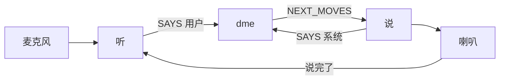

# `sisu/src/isu.ts`

浏览器里负责听和说的那一层。它启动 SpeechState，把识别到的英文交给 `nlu`，把 `dme` 的 `NEXT_MOVES` 交给 `nlg` 再朗读。下一句该说什么，不写在这里，写在它调用的 `dme` 里。

自动测试不加载这个文件。

## 折叠大纲

```text
isu.ts
├─ 10–26    调试面板和 Azure 语音设置
├─ 28–48    朗读、开始听
├─ 49–147   状态机
│  ├─ 59–67    等语音准备好，再等用户点按钮
│  └─ 68–145   三个区域同时跑：听、说、dme
│     ├─ 71–102   听
│     ├─ 103–129  说
│     └─ 130–143  启动 dme
└─ 149–177  页面一打开就启动，并接上按钮
```

## 10–26 行：语音设置

```text
打开浏览器里的 Stately 调试面板
从 ./azure 读取 KEY
连到北欧的 Azure，语言 en-US，声音 en-US-DavisNeural
5 秒没人说话算超时
不许中途打断（bargeIn: false）
```

`src/azure.ts` 不在仓库里。课程 README 让你在本地自己建，并且不要把密钥提交上去。只跑 `npm test` 时不会执行到这一行。

## 28–48 行：两件外面才做的事

```text
跑起来的内部程序只有 dme

朗读:
  把事件里的 move 用 nlg 变成英文
  让语音程序去 SPEAK

开始听:
  让语音程序去 LISTEN
```

`ssRef` 就是这块语音程序，在记录初始化时创建出来。

## 49–67 行：等用户按按钮

```text
一开始:
  ssRef = 语音程序
  is = initialIS()

准备:
  一进来就发送 PREPARE
  收到 ASRTTS_READY 之后，去等点击

等待:
  收到 CLICK 才进入正式对话
```

所以打开页面不会马上说话。按钮被点之后才开始。`dme` 在这时启动，一启动就会选出打招呼，并请求朗读。

## 71–102 行：听

```text
空闲:
  收到 SPEAK_COMPLETE（系统说完了）
    -> 开始听

正在听:
  RECOGNISED 识别到一句:
    lastUserMoves = nlu(识别结果的第一句)
    先留在这里
  LISTEN_COMPLETE 这一轮听完了:
    向 dme 发送 SAYS { speaker: usr, moves: lastUserMoves }
    回到空闲
  ASR_NOINPUT 没人说话:
    空着，还没写处理
```

「识别到文字」和「这一轮听完了」是两个事件。`nlu` 在识别到文字时就跑了。等这一轮听完，才把准备好的 `move` 送进 `dme`。

`ASR_NOINPUT` 现在什么都不做。语音里的「没听见」还没有接到规则上。

## 103–129 行：说

```text
空闲:
  收到 NEXT_MOVES:
    先向 dme 发送 SAYS { speaker: sys, moves: 这组 move }
    再进入「正在说」

正在说:
  一进来就朗读，也就是 nlg 之后 SPEAK
  收到 SPEAK_COMPLETE 回到空闲
```

和测试一样，系统自己的 `move` 会送回 `dme`。听的那边要等 `SPEAK_COMPLETE` 才打开麦克风，所以不会把自己的声音当成用户的话。

## 130–143 行：启动 `dme`

```text
启动 dme，名字叫 dmeID
交给它 parentRef = 这层自己
以及当时的 latest_moves、latest_speaker、is
```

这和 `dme.test.ts` 里的启动是同一份约定。`dme` 分不清外面是测试还是麦克风。

听、说、`dme` 三块同时跑，靠 `SAYS` 和 `NEXT_MOVES` 传话。



## 149–177 行：页面一打开就跑

```text
文件一加载就创建并启动
每次状态变化，把状态名和 is 打到控制台

setupButton(按钮):
  点击就发送 CLICK
  语音状态变了，就把当前画面提示写进按钮文字
```

按钮上的字来自 SpeechState 的界面提示，不是来自对话记录。要看 `qud`、`plan` 这些，看浏览器控制台里的 `is`，或者打开调试面板。
