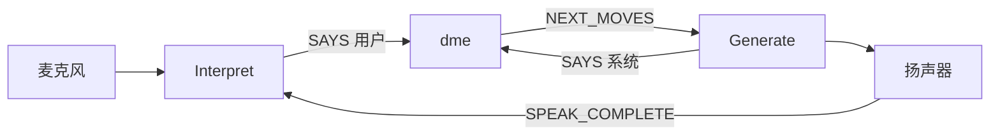

# `sisu/src/isu.ts`

浏览器里的语音外壳。它启动 SpeechState，把识别到的文字交给 `nlu`，把引擎的 `NEXT_MOVES` 交给 `nlg` 再朗读。对话策略不写在这里，策略在被它调用的 `dme` 里。

自动测试不加载这个文件。

## 折叠大纲

```text
isu.ts
├─ 10–26    检查器和 Azure / 语音设置
├─ 28–48    dmMachine 的演员、朗读、倾听
├─ 49–147   状态机
│  ├─ 59–67    Prepare、WaitToStart
│  └─ 68–145   Main 三个并行区域
│     ├─ 71–102   Interpret 听
│     ├─ 103–129  Generate 说
│     └─ 130–143  DME 启动引擎
└─ 149–177  启动演员、打日志、setupButton
```

## 10–26 行：语音设置

```text
创建浏览器里的 Stately 检查器
从 ./azure 读取 KEY
连到北欧 Azure，语言 en-US，声音 en-US-DavisNeural
无人说话 5000 毫秒算超时
不许打断（bargeIn: false）
```

`src/azure.ts` 不在仓库里。README 要求本地自己建，并且不要把密钥提交上去。只跑 `npm test` 时不会执行到这一行。

## 28–48 行：外壳的两个动作

```text
演员: 只有 dme

speak_next_moves:
  把事件里的 Move 用 nlg 变成字符串
  让 ssRef 去 SPEAK

listen:
  让 ssRef 去 LISTEN
```

`ssRef` 是 SpeechState 演员，在上下文初始化时 `spawn` 出来。

## 49–67 行：等到用户按按钮

```text
context:
  ssRef = 语音演员
  is = initialIS()

Prepare:
  进入时发送 PREPARE
  收到 ASRTTS_READY 后进入 WaitToStart

WaitToStart:
  收到 CLICK 才进入 Main
```

所以打开页面不会马上说话。按钮被点击后才进入主循环。引擎在 Main 里启动，一启动就会选出打招呼并请求朗读。

## 71–102 行：Interpret

```text
Idle:
  收到 SPEAK_COMPLETE -> 开始听，进入 Recognising

Recognising:
  RECOGNISED:
    lastUserMoves = nlu(识别结果的第一句)
    留在 Recognising
  LISTEN_COMPLETE:
    向引擎发送 SAYS { speaker: usr, moves: lastUserMoves }
    回到 Idle
  ASR_NOINPUT:
    空着，还没有处理
```

识别和「听这一轮结束」是两个事件。`nlu` 在识别到文字时就跑了；等这一轮倾听结束，才把已经准备好的 Move 送进引擎。

`ASR_NOINPUT` 目前什么都不做。语音里的「没听见」还没有接到规则上。

## 103–129 行：Generate

```text
Idle:
  收到 NEXT_MOVES:
    先向引擎发送 SAYS { speaker: sys, moves: 这组 Move }
    再进入 Speaking

Speaking:
  进入时 speak_next_moves，也就是 nlg 之后 SPEAK
  收到 SPEAK_COMPLETE 回到 Idle
```

和测试一样，系统自己的 Move 会送回引擎。送回发生在真正朗读的同时进入 Speaking。Interpret 要等 `SPEAK_COMPLETE` 才开始听，所以不会把自己的声音当成用户的话。

## 130–143 行：DME

```text
invoke dme，id 为 dmeID
输入 parentRef = 外壳自己
以及当时的 latest_moves、latest_speaker、is
```

这和 `dme.test.ts` 里的 invoke 是同一份合同。引擎分不清外层是测试还是麦克风。

三个区域是并行的：听、说、引擎各跑各的，靠 `SAYS` 和 `NEXT_MOVES` 通信。



## 149–177 行：页面上的演员

```text
立刻 createActor 并 start
订阅每一次快照，把状态名和 is 打到控制台
setupButton(按钮):
  点击就发送 CLICK
  订阅语音演员，把当前 meta.view 写进按钮文字
```

按钮上的字来自 SpeechState 的视图元数据，不是来自信息状态。调试对话内容要看控制台里的 `is`，或者打开检查器。
